<div align="center">

# FIT Protocol

**F**ully **I**ntegrated **T**oolchain — one root for every runtime, one registry for every tool and agent, five ways in.

*一台机器一个环境根目录，一份注册表登记所有工具与 Agent，五种方式接入。*

[](LICENSE)
[](SPEC.md)
[](docs/PROTOCOLS.md)
[](https://github.com/songconmaisaix31-design/fit-protocol/actions/workflows/ci.yml)
[](https://github.com/songconmaisaix31-design/fit-protocol/actions/workflows/demo.yml)
[](#requirements)
[](package.json)

</div>

<div align="center">



<sub>Regenerated by GitHub Actions from real CLI output on every push — not a mock-up. · 由 GitHub Actions 用真实 CLI 输出生成，每次推送自动更新。</sub>

</div>

<div align="center">

**English** · [**中文**](#中文)

</div>

---

# English

## At a glance

| | |
|---|---|
| **Problem** | Runtimes installed N times, dependencies downloaded N times, and every agent configured against its own private list of tools |
| **Fix** | One root (store + cache) and one registry, reachable over CLI, MCP, HTTP/A2A and two SDKs |
| **Cost** | One directory, five environment variables, two shell profiles, **zero npm dependencies** |
| **Not** | A package manager, a container runtime, a chat proxy, or a cleanup tool that deletes things |

## The problem

Every machine drifts the same way:

```text
C:\Program Files\nodejs\      ← node 24
C:\node-win-x64\              ← node 22, forgotten
project-a\.venv\              ← python + 800 MB of packages
project-b\.venv\              ← the same packages again
npm-cache\ pnpm\store\ uv\cache\ pip\cache\   ← five caches, none shared
claude/mcp.json  cursor/mcp.json  codex/mcp.json   ← three tool lists that disagree
```

None of this is a tooling failure. It is the absence of a **place** — and, once
agents arrive, the absence of a **catalogue**. Cleaning up does not fix it: the drift
returns with the next project, because nothing changed about where things go.

## The idea

Four nouns and one file carry the whole protocol:

| Noun | Path | Rule |
|---|---|---|
| **Root** | `<Root>` | Everything lives under it. Local disk, no spaces. |
| **Store** | `<Root>/mise` | Each runtime version exists **at most once**. |
| **Cache** | `<Root>/cache` | Every package manager resolves here. |
| **Registry** | `<Root>/registry/fit.json` | Every endpoint is described **exactly once**. |

The practical test: **delete a project's `node_modules` and reinstall it — it must
not hit the network.** If it does, the cache is not shared and the protocol is not
implemented. Same test for the catalogue: *one* `fit list` must tell an agent
everything, whatever protocol it speaks.

Eight environment invariants plus two registry ones (I9 single registry, I10 surface
parity) are specified normatively in [SPEC.md](SPEC.md#4-invariants).

## Five kinds, five surfaces

**Kinds** — what can be registered:

| Kind | Points at | `fit probe` does |
|---|---|---|
| `env` | an executable on `PATH` | runs `--version`, reports resolved path |
| `skill` | a directory with `SKILL.md` | checks the entry file |
| `mcp` | an MCP server | `initialize` → `tools/list` |
| `acp` | an ACP agent | `initialize`, returns `agentInfo` |
| `a2a` | a remote agent | fetches `/.well-known/agent-card.json` |

**Surfaces** — how to reach the registry:

| Surface | Entry point | Use when |
|---|---|---|
| CLI | `fit list / register / probe` | shell, CI, humans |
| MCP | `fit serve mcp` | the agent already speaks MCP |
| HTTP + A2A | `fit serve http --port 7777` | another machine or an A2A peer |
| JS SDK | `import { Fit } from 'fit-protocol'` | Node runtime, in-process |
| Python SDK | `from fit_sdk import Fit` | Python runtime |

HTTP is deliberately read-only; parity details and explicit non-goals are in
[docs/PROTOCOLS.md](docs/PROTOCOLS.md).

## Quickstart

### Requirements

PowerShell 5.1+ (for the environment half), Node 18+ (for the registry half),
[mise](https://mise.jdx.dev) (installed with `-InstallMise` or `winget install jdx.mise`).

### 1. Environment — make things exist once

```powershell
git clone https://github.com/songconmaisaix31-design/fit-protocol.git
cd fit-protocol

pwsh -File scripts/setup-env.ps1 -Root D:\env -WhatIf   # preview, writes nothing
pwsh -File scripts/setup-env.ps1 -Root D:\env -InstallMise -WireProfile
```

Open a **new** terminal (environment variables apply to new processes only), then:

```powershell
tools list      # every managed tool, one path each
tools doctor    # store + cache locations, disk, mise health
```

### 2. Registry — tell the machine what it offers

```bash
node bin/fit.mjs discover --skills ~/.agents/skills --env --save
node bin/fit.mjs list
node bin/fit.mjs probe node
```

### 3. Attach an agent

```bash
# an agent registers itself, then reads the shared catalogue
node bin/fit.mjs agent register my-agent --transport mcp --capabilities registry.read
node bin/fit.mjs list --kind skill --json

# or let it connect over MCP and do the same
node examples/mcp-client.mjs --root D:\env
```

## Documentation

| Doc | Covers |
|---|---|
| [docs/CLI.md](docs/CLI.md) | every command, flag, exit code, JSON shape |
| [docs/REGISTRY.md](docs/REGISTRY.md) | `fit.json` schema, kinds, identity, hand editing |
| [docs/MCP.md](docs/MCP.md) | the six MCP tools, client config, error behaviour |
| [docs/SDK.md](docs/SDK.md) | JavaScript and Python APIs |
| [docs/ENVIRONMENT.md](docs/ENVIRONMENT.md) | root/store/cache, setup script, `tools.ps1` |
| [docs/PROTOCOLS.md](docs/PROTOCOLS.md) | surfaces vs. kinds, parity table, non-goals |
| [docs/AUTOMATION.md](docs/AUTOMATION.md) | how the animation above is generated |
| [SPEC.md](SPEC.md) | normative specification, invariants, conformance levels |

## Repository layout

```text
fit-protocol/
├── bin/fit.mjs              # CLI surface
├── core/                    # registry model, discovery, MCP/ACP/A2A probes
├── adapters/                # mcp-server.mjs · http-server.mjs
├── sdk/{js,py}/             # SDK surfaces
├── scripts/                 # environment half: setup-env.ps1 · tools.ps1
├── assets/repo-template/    # per-repository dispatcher template
├── assets/demo/             # the animated card (generated by Actions)
├── tools/make-demo-svg.mjs  # renders the card from real CLI output
├── docs/                    # per-feature documentation
├── test/                    # 12-check smoke suite + stub MCP/ACP/A2A peers
├── .github/workflows/       # ci.yml · demo.yml
├── SPEC.md                  # the protocol
└── SKILL.md                 # the same repo is also an agent skill
```

## Status

v0.2 — draft. The multi-surface layer is new; the environment half was exercised on
a real machine (two nearly-full volumes, ~130 GB reclaimed before adoption). Twelve
end-to-end checks run on every push. Not yet exercised on Linux/macOS for the
environment half.

Known limits, stated rather than hidden: MCP does not proxy other servers' tools;
ACP is probe-only; A2A implements discovery plus one request/response shape, no
streaming; the registry has no file lock (single-writer).

## License

[MIT](LICENSE) © 2026 Dawei

---

# 中文

## 一句话

散落的开发环境收进一个根目录，散落的工具与 Agent 收进一份注册表，五种方式接入。

| | |
|---|---|
| **问题** | 运行时装 N 份、依赖下 N 遍、每个 Agent 各配一份工具清单 |
| **做法** | 一个根目录（运行时 + 缓存）+ 一份注册表，CLI / MCP / HTTP(A2A) / JS SDK / Python SDK 五种接入 |
| **代价** | 一个目录、五个环境变量、两个 shell profile、**零 npm 依赖** |
| **不是** | 包管理器、容器运行时、聊天代理，也不是会删东西的清理工具 |

## 问题在哪

```text
C:\Program Files\nodejs\      ← node 24
C:\node-win-x64\              ← node 22，忘了
project-a\.venv\              ← python + 800 MB 依赖
project-b\.venv\              ← 同样的依赖再来一遍
npm-cache\ pnpm\store\ uv\cache\ pip\cache\   ← 五份缓存，互不相通
claude/mcp.json  cursor/mcp.json  codex/mcp.json   ← 三份互不一致的工具清单
```

这不是工具的问题，是**没有"位置"**；等 Agent 来了之后，还多一个**没有"目录"**。
清理治不了根：下一个项目一开，一切照旧，因为"东西放哪"这件事没变。

## 思路

四个名词 + 一个文件，就是全部约定：

| 名词 | 路径 | 规则 |
|---|---|---|
| **Root** | `<Root>` | 一切都在这下面。本地盘、路径不带空格。 |
| **Store** | `<Root>/mise` | 每个运行时版本**最多一份**。 |
| **Cache** | `<Root>/cache` | 所有包管理器都指到这里。 |
| **Registry** | `<Root>/registry/fit.json` | 每个端点**只描述一次**。 |

判断标准很硬：**删掉某个项目的 `node_modules` 重装，不应该产生下载**。
目录那半边同理：**一条 `fit list` 就要能让任何协议的 Agent 知道这台机器有什么**。

8 条环境不变量 + 2 条注册表不变量（I9 单一注册表、I10 接入面对等）写在
[SPEC.md](SPEC.md#4-invariants)。

## 五类端点，五个接入面

**五类端点**（能登记什么）：

| kind | 指向 | `fit probe` 做什么 |
|---|---|---|
| `env` | PATH 上的可执行文件 | 跑 `--version`，报真实路径 |
| `skill` | 带 `SKILL.md` 的目录 | 校验入口文件 |
| `mcp` | MCP server | `initialize` → `tools/list` |
| `acp` | ACP agent | `initialize`，返回 `agentInfo` |
| `a2a` | 远程 agent | 抓 `/.well-known/agent-card.json` |

**五个接入面**（怎么读这份注册表）：

| 接入面 | 入口 | 什么时候用 |
|---|---|---|
| CLI | `fit list / register / probe` | shell、CI、人 |
| MCP | `fit serve mcp` | Agent 本来就说 MCP |
| HTTP + A2A | `fit serve http --port 7777` | 另一台机器 / A2A 对端 |
| JS SDK | `import { Fit } from 'fit-protocol'` | Node 运行时，进程内 |
| Python SDK | `from fit_sdk import Fit` | Python 运行时 |

HTTP 是**故意只读**的。能力对照与"明确没做"的部分见
[docs/PROTOCOLS.md](docs/PROTOCOLS.md)。

## 快速开始

### 环境要求

PowerShell 5.1+（环境那半边）、Node 18+（注册表那半边）、
[mise](https://mise.jdx.dev)（`-InstallMise` 自动装，或 `winget install jdx.mise`）。

### 1. 环境：让东西只存在一份

```powershell
git clone https://github.com/songconmaisaix31-design/fit-protocol.git
cd fit-protocol

pwsh -File scripts/setup-env.ps1 -Root D:\env -WhatIf   # 只看不改
pwsh -File scripts/setup-env.ps1 -Root D:\env -InstallMise -WireProfile
```

**重开一个终端**（环境变量只对新进程生效），然后：

```powershell
tools list      # 每个工具一条路径
tools doctor    # store / cache 位置、磁盘、mise 状态
```

### 2. 注册表：告诉机器它有什么

```bash
node bin/fit.mjs discover --skills ~/.agents/skills --env --save
node bin/fit.mjs list
node bin/fit.mjs probe node
```

### 3. 接上 Agent

```bash
# Agent 自己注册，然后读共享目录
node bin/fit.mjs agent register my-agent --transport mcp --capabilities registry.read
node bin/fit.mjs list --kind skill --json

# 或者直接走 MCP 做同样的事
node examples/mcp-client.mjs --root D:\env
```

## 文档

| 文档 | 内容 |
|---|---|
| [docs/CLI.md](docs/CLI.md) | 每个命令、参数、退出码、JSON 形状 |
| [docs/REGISTRY.md](docs/REGISTRY.md) | `fit.json` 结构、五类端点、身份规则、手改注意事项 |
| [docs/MCP.md](docs/MCP.md) | 六个 MCP 工具、客户端配置、错误行为 |
| [docs/SDK.md](docs/SDK.md) | JavaScript 与 Python 两套 API |
| [docs/ENVIRONMENT.md](docs/ENVIRONMENT.md) | 根目录 / store / cache、初始化脚本、`tools.ps1` |
| [docs/PROTOCOLS.md](docs/PROTOCOLS.md) | 接入面 × 端点类型、对等表、明确没做的 |
| [docs/AUTOMATION.md](docs/AUTOMATION.md) | 上面那段动画是怎么生成的 |
| [SPEC.md](SPEC.md) | 规范正文：不变量、符合性等级 |

## 仓库结构

```text
fit-protocol/
├── bin/fit.mjs              # CLI 接入面
├── core/                    # 注册表模型、发现、MCP/ACP/A2A 探测
├── adapters/                # mcp-server.mjs · http-server.mjs
├── sdk/{js,py}/             # 两种 SDK 接入面
├── scripts/                 # 环境那半边：setup-env.ps1 · tools.ps1
├── assets/repo-template/    # 仓库级入口模板
├── assets/demo/             # 动画卡片（Actions 生成）
├── tools/make-demo-svg.mjs  # 用真实 CLI 输出渲染卡片
├── docs/                    # 分功能文档
├── test/                    # 12 项冒烟测试 + MCP/ACP/A2A 桩
├── .github/workflows/       # ci.yml · demo.yml
├── SPEC.md                  # 协议规范
└── SKILL.md                 # 同一个仓库同时也是一个 agent skill
```

## 状态

v0.2 草稿。多端接入层是这次新加的；环境那半边在真机上跑过（两个快满的盘，
接入前回收约 130 GB）。每次推送跑 12 项端到端测试。环境那半边尚未在
Linux/macOS 上验证。

边界写出来而不是藏起来：MCP 不代理其他 server 的工具；ACP 只做握手探测；
A2A 只实现发现 + 一问一答，没有流式；注册表没有文件锁（单写者）。

## 许可

[MIT](LICENSE) © 2026 Dawei
